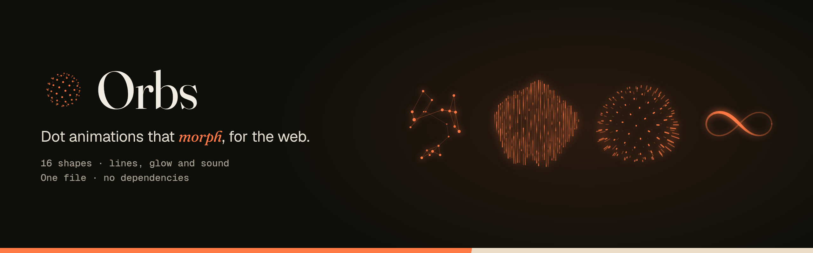
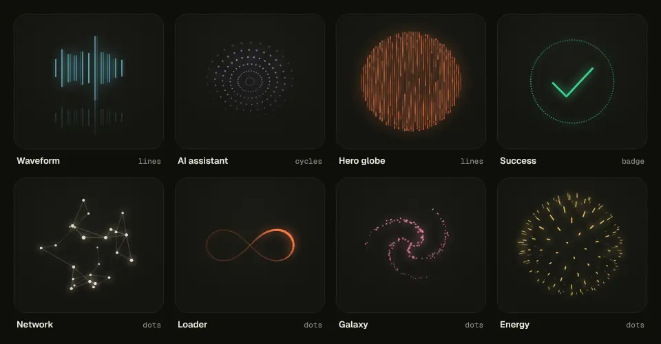

# Orbs

[](LICENSE)


[](https://www.jsdelivr.com/package/gh/ShazMoghaddam/orbs)
[](https://github.com/ShazMoghaddam/orbs)

Sixteen morphing dot-formation animations for the web. Use them for loaders, AI "listening", "thinking" and "speaking" states, success and error badges, or one memorable moment in a hero.

One file, about 9.5 KB gzipped, no dependencies, no build step.

**[Open the Studio](https://shazmoghaddam.github.io/orbs/#studio)** to design an orb and copy its code · See one in a real page in the Contact section of [shazmoghaddam.github.io](https://shazmoghaddam.github.io)



## Quick start

Add a canvas, size it with CSS, then load the script.

```html
<canvas data-orb="torus" style="width:200px; height:200px; color:#FF4400" aria-hidden="true"></canvas>

<script src="https://cdn.jsdelivr.net/gh/ShazMoghaddam/orbs@1.4.0/orb.min.js" defer></script>
```

Every `<canvas data-orb>` on the page starts automatically. The dots use the canvas's CSS `color`, so you theme an orb the same way you theme text.

You can also download `orb.min.js` and host it yourself.

## Shapes

| Shape | What it looks like |
| --- | --- |
| `sphere` | Evenly spread dots on a slowly turning globe |
| `wave` | A liquid surface that swells, with brighter crests |
| `spikes` | Every dot becomes a spine, rippling like an audio visualiser |
| `constellation` | Star nodes linked to their nearest neighbours, twinkling |
| `torus` | A donut seen almost face-on, its surface rolling inside out |
| `helix` | A double helix with rungs |
| `galaxy` | Three spiral arms around a bright core, gently swaying |
| `ticks` | A dashed loader ring with a pulse chasing round it |
| `cube` | A wireframe cube built from dots |
| `clusters` | Four k-means style clusters breathing, linked to their centroids |
| `ripple` | Rings spreading out from the centre and fading, for listening |
| `bars` | Columns of dots rising and falling, for speaking |
| `atom` | A small nucleus with three orbits, each carrying a bright electron |
| `infinity` | A figure of eight with a bright pulse running round it |
| `check` | A success badge: a dotted ring with a tick inside |
| `cross` | An error badge: the same ring with an X inside |

Any shape can morph into any other. Dots leave in a top-to-bottom cascade, and lines and dashes fade in and out with the morph.

`check` and `cross` are status badges, so they are left out of the default cycle. Morph to them yourself, or list them in `data-shapes`. Flat shapes (`bars`, `infinity`, `check` and `cross`) turn to face the viewer instead of spinning, so they always read clearly. `atom` is busy at loader size, so use it at about 120 px or larger.

## Options

Set options as `data-` attributes, or pass them to the constructor.

| Attribute | JS option | Default | What it does |
| --- | --- | --- | --- |
| `data-orb` | `shape` | `sphere` | Starting shape |
| `data-shapes` | `shapes` | all except `check` and `cross` | Comma list of shapes to cycle through |
| `data-points` | `points` | `180`, or `320` with lines | Number of dots. Use 60 to 100 for small loaders |
| `data-dot` | `dot` | `1.2` | Dot radius in CSS pixels |
| `data-speed` | `speed` | `0.35` | Rotation speed in radians per second |
| `data-cycle` | `cycle` | `0` | Milliseconds between automatic morphs. `0` turns it off |
| `data-hover="morph"` | `hover: 'morph'` | off | Morph to the next shape on hover or tap |
| `data-click="morph"` | `click: 'morph'` | off | Morph to the next shape only on click or tap. Wrap the canvas in a `<button>` so keyboard users can use it too |
| `data-theme-morph` | `themeMorph: true` | off | Morph when `<body>`'s `data-theme` or `class` changes |
| `data-style` | `style` | `dots` | `lines` draws the shape as glowing vertical slices. See [Lines style](#lines-style) |
| `data-line` | `line` | auto | Line thickness in CSS pixels, for slices and connecting lines |
| `data-glow` | `glow` | off | A soft glow behind the shape. On its own it uses 8 px; a number sets the size |
| `data-audio` | `audio` | off | CSS selector of an `<audio>` or `<video>` to react to once it plays. See [React to sound](#react-to-sound) |
| `data-audio-amount` | `audioAmount` | `1` | How strongly it reacts to sound |
| `data-tilt` | `tilt` | `0` | Extra tilt in degrees, added to each shape's own angle |
| `data-reflect` | `reflect` | off | A faded mirror image underneath. On its own it uses 0.35; a number from 0 to 1 sets its strength |

## Lines style

Any shape can be drawn as glowing vertical slices instead of dots, inspired by the scan-line look in music videos. Solid shapes like `sphere`, `wave` and `torus` become sliced silhouettes, `bars` becomes a waveform, and `check`, `cross` and `infinity` keep their clean outlines.

```html
<canvas data-orb="bars" data-style="lines" data-glow data-reflect
        style="width:320px;height:320px;color:#6FD8F2" aria-hidden="true"></canvas>
```

`data-glow` and `data-reflect` work with dots too. Lines look best from about 120 px up, and on dark backgrounds with a bright colour. `constellation` and `clusters` are sparse, so they suit dots better. See [`examples/lines.html`](examples/lines.html).

## React to sound

An orb can move with music, a voice or a microphone. `bars` follows the actual frequencies, bass in the middle and treble at the edges. Other shapes pulse with the volume and push out on the beat, and flat marks like `check` only pulse, so they stay readable.

With an audio or video player on the page, no JavaScript is needed:

```html
<audio id="player" src="track.mp3" controls></audio>
<canvas data-orb="bars" data-style="lines" data-glow data-audio="#player" aria-hidden="true"></canvas>
```

Or from JavaScript, call `listen` from a click, since browsers only start audio after a user gesture:

```js
button.addEventListener('click', () => orb.listen('mic'));   // a microphone, a MediaStream,
orb.listen(videoElement);                                     // an <audio> or <video>,
orb.listen(myAudioNode);                                      // or any Web Audio node
orb.unlisten();                                               // stop reacting

orb.audio.level;   // 0 to 1, while listening
orb.audio.bands;   // 16 values from bass to treble, 0 to 1
```

- **Microphone:** sound is analysed in the browser and never played back, recorded or sent anywhere. The browser asks for permission, and it needs HTTPS (or localhost).
- **Audio from another site:** a file served from a different domain needs CORS headers and `crossorigin="anonymous"` on the element. Without them the browser silences it once Orbs is connected, which is a browser rule rather than something Orbs can work around. Pages opened straight from disk (`file://`) count as another site too, so test audio files through a local server, for example `python3 -m http.server`.
- **Web Audio nodes:** use `Orb.audioContext()` to create them, so they share the orb's audio context.
- Shapes can define their own `audio(i, data, A, p, out)` hook, as `bars` does.

See [`examples/audio.html`](examples/audio.html), which has a built-in demo beat, a microphone button and a file picker.

## JavaScript API

```js
const orb = new Orb(canvas, { shape: 'wave', points: 90 });

orb.morph('ticks');   // go to a specific shape
orb.next();           // go to the next shape in `shapes`
orb.set({ style: 'lines', glow: 10, speed: 0.6 });   // change settings while it runs
orb.destroy();        // stop and remove listeners

canvas.addEventListener('orb:morph', e => console.log(e.detail.shape));   // after every morph

Orb.shapes;           // every registered shape
Orb.init(root);       // start any <canvas data-orb> added after the page loaded
```

`set` takes any option from the table above except the shape list for hover and click, and changes it without restarting the orb. Changing `points` rebuilds the shape in place. `Orb.init` is handy in React, Vue or anything else that adds canvases later; it skips canvases that are already running.

Morphing one orb between states reads better than swapping spinners. For example:

```js
orb.morph('ripple');  // listening
orb.morph('ticks');   // thinking
orb.morph('bars');    // speaking
orb.morph('check');   // done
orb.morph('cross');   // something went wrong
```

See [`examples/loader.html`](examples/loader.html).

## Custom shapes

`Orb.define` registers a new shape. `build(n)` must return `n` points inside the unit sphere. Everything else is optional.

```js
Orb.define('ring2', {
  build(n) {
    const pts = [];
    for (let i = 0; i < n; i++) {
      const a = (i / n) * Math.PI * 2;
      pts.push([Math.cos(a) * 0.8, (i % 2 ? 0.1 : -0.1), Math.sin(a) * 0.8]);
    }
    return { pts };
  },
  tilt: 1.2,                       // camera tilt in radians
  spin: 0.5,                       // rotation multiplier
  face: false,                     // true turns the orb to face the viewer instead of spinning
  inCycle: true,                   // false leaves the shape out of the default cycle
  lineGap: 0.45,                   // lines style: the widest gap (in radii) still joined into one line
  size: 1,                         // dot size multiplier, number or function(i, data, t, p)
  alpha: 1,                        // opacity multiplier, number or function(i, data, t, p)
  dash: (i, data, t, p) => 0,      // above 0, draws a radial stroke of that length instead of a dot
  audio(i, data, A, p, out) {},   // optional: react to sound. A.bands (16) and A.level are 0 to 1
  deform(i, data, t, p, out) {     // live motion: write a moved copy of p into out
    out[0] = p[0]; out[1] = p[1] + Math.sin(t + i) * 0.05; out[2] = p[2];
  }
});
```

To draw lines between points, return `edges: [[i, j], ...]` from `build` and set `edgeAlpha` on the shape.

## Turning a letter into an orb

Keep the real letter in the HTML and lay the canvas over it. Search engines and screen readers still read the word, and if the script fails the letter simply shows. See [`examples/letter.html`](examples/letter.html).

```html
<h1>Hell<span class="orb-letter">o<canvas data-orb="sphere" aria-hidden="true"></canvas></span></h1>
```

```css
.orb-letter { position: relative; display: inline-block; }
.orb-letter canvas { position: absolute; left: 50%; top: 62%; width: .72em; height: .72em; transform: translate(-50%, -50%); }
.orb-letter.orb-ready { color: transparent; }   /* added by the script once the orb is running */
```

The `top` and `width` values depend on your typeface, so nudge them until the orb sits on the letter's x-height.

## Accessibility and performance

- When the visitor has reduced motion turned on, each orb shows a still frame, morphs happen instantly, and orbs don't react to sound.
- Orbs only animate while they are on screen and the tab is visible.
- Canvases render at device pixel ratio (capped at 2) and resize with their container.
- The lines style costs a little more than dots. Glow and reflection each copy the finished frame, so they are off unless you ask for them. Glow is blurred at quarter size to keep it cheap, and browsers without canvas filters simply skip it.
- Orbs are decorative. Add `aria-hidden="true"` to the canvas and put any status text next to it, as the loader example does.

## Browser support

Any current browser with canvas, `requestAnimationFrame` and `ResizeObserver`. Older browsers fall back to window resize events.

## Building from source

`orb.min.js` is generated from `orb.js` with terser. After changing `orb.js`, rebuild it:

```bash
npm install
npm run build
```

Then open `index.html` or the files in `examples/` to check the result.

If Orbs is useful to you, a star on the repo helps other developers find it.

## License

MIT. Use it in anything, commercial included. A link back is appreciated but not required.

Made by [Shaz Moghaddam](https://shazmoghaddam.github.io) in London.
