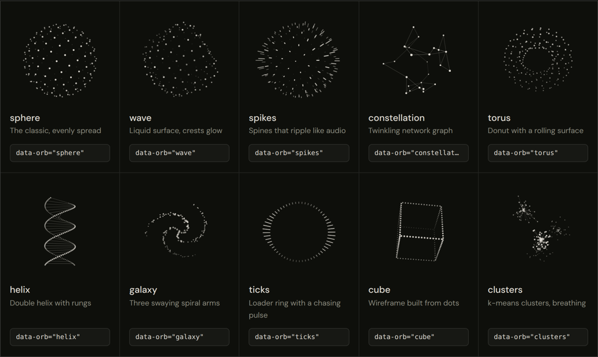

# Orbs

[](LICENSE)


[](https://www.jsdelivr.com/package/gh/ShazMoghaddam/orbs)
[](https://github.com/ShazMoghaddam/orbs)

Ten morphing dot-formation animations for the web. Use them for loaders, AI "thinking" states, or one memorable moment in a hero.

One file, about 5 KB gzipped, no dependencies, no build step.

**[Live demo](https://shazmoghaddam.github.io/orbs)**



## Quick start

Add a canvas, size it with CSS, then load the script.

```html
<canvas data-orb="torus" style="width:200px; height:200px; color:#FF4400" aria-hidden="true"></canvas>

<script src="https://cdn.jsdelivr.net/gh/ShazMoghaddam/orbs@1.0.3/orb.min.js" defer></script>
```

Every `<canvas data-orb>` on the page starts automatically. The dots use the canvas's CSS `color`, so you theme an orb the same way you theme text.

You can also download `orb.min.js` and host it yourself.

## Shapes

| Shape | What it looks like |
| --- | --- |
| `sphere` | Evenly spread dots on a slowly turning globe |
| `wave` | A liquid surface that swells, with brighter crests |
| `spikes` | Every dot becomes a spine, rippling like an audio visualiser |
| `constellation` | Star nodes linked to their nearest neighbours, twinkling |
| `torus` | A donut seen almost face-on, its surface rolling inside out |
| `helix` | A double helix with rungs |
| `galaxy` | Three spiral arms around a bright core, gently swaying |
| `ticks` | A dashed loader ring with a pulse chasing round it |
| `cube` | A wireframe cube built from dots |
| `clusters` | Four k-means style clusters breathing, linked to their centroids |

Any shape can morph into any other. Dots leave in a top-to-bottom cascade, and lines and dashes fade in and out with the morph.

## Options

Set options as `data-` attributes, or pass them to the constructor.

| Attribute | JS option | Default | What it does |
| --- | --- | --- | --- |
| `data-orb` | `shape` | `sphere` | Starting shape |
| `data-shapes` | `shapes` | all | Comma list of shapes to cycle through |
| `data-points` | `points` | `180` | Number of dots. Use 60 to 100 for small loaders |
| `data-dot` | `dot` | `1.2` | Dot radius in CSS pixels |
| `data-speed` | `speed` | `0.35` | Rotation speed in radians per second |
| `data-cycle` | `cycle` | `0` | Milliseconds between automatic morphs. `0` turns it off |
| `data-hover="morph"` | `hover: 'morph'` | off | Morph to the next shape on hover or tap |
| `data-click="morph"` | `click: 'morph'` | off | Morph to the next shape only on click or tap. Wrap the canvas in a `<button>` so keyboard users can use it too |
| `data-theme-morph` | `themeMorph: true` | off | Morph when `<body>`'s `data-theme` or `class` changes |

## JavaScript API

```js
const orb = new Orb(canvas, { shape: 'wave', points: 90 });

orb.morph('ticks');   // go to a specific shape
orb.next();           // go to the next shape in `shapes`
orb.destroy();        // stop and remove listeners

Orb.shapes;           // every registered shape
```

Morphing one orb between states reads better than swapping spinners. For example:

```js
orb.morph('wave');    // listening
orb.morph('ticks');   // thinking
orb.morph('spikes');  // speaking
```

See [`examples/loader.html`](examples/loader.html).

## Custom shapes

`Orb.define` registers a new shape. `build(n)` must return `n` points inside the unit sphere. Everything else is optional.

```js
Orb.define('ring2', {
  build(n) {
    const pts = [];
    for (let i = 0; i < n; i++) {
      const a = (i / n) * Math.PI * 2;
      pts.push([Math.cos(a) * 0.8, (i % 2 ? 0.1 : -0.1), Math.sin(a) * 0.8]);
    }
    return { pts };
  },
  tilt: 1.2,                       // camera tilt in radians
  spin: 0.5,                       // rotation multiplier
  size: 1,                         // dot size multiplier, number or function(i, data, t, p)
  alpha: 1,                        // opacity multiplier, number or function(i, data, t, p)
  dash: (i, data, t, p) => 0,      // above 0, draws a radial stroke of that length instead of a dot
  deform(i, data, t, p, out) {     // live motion: write a moved copy of p into out
    out[0] = p[0]; out[1] = p[1] + Math.sin(t + i) * 0.05; out[2] = p[2];
  }
});
```

To draw lines between points, return `edges: [[i, j], ...]` from `build` and set `edgeAlpha` on the shape.

## Turning a letter into an orb

Keep the real letter in the HTML and lay the canvas over it. Search engines and screen readers still read the word, and if the script fails the letter simply shows. See [`examples/letter.html`](examples/letter.html).

```html
<h1>Hell<span class="orb-letter">o<canvas data-orb="sphere" aria-hidden="true"></canvas></span></h1>
```

```css
.orb-letter { position: relative; display: inline-block; }
.orb-letter canvas { position: absolute; left: 50%; top: 62%; width: .72em; height: .72em; transform: translate(-50%, -50%); }
.orb-letter.orb-ready { color: transparent; }   /* added by the script once the orb is running */
```

The `top` and `width` values depend on your typeface, so nudge them until the orb sits on the letter's x-height.

## Accessibility and performance

- When the visitor has reduced motion turned on, each orb shows a still frame, and morphs happen instantly.
- Orbs only animate while they are on screen and the tab is visible.
- Canvases render at device pixel ratio (capped at 2) and resize with their container.
- Orbs are decorative. Add `aria-hidden="true"` to the canvas and put any status text next to it, as the loader example does.

## Browser support

Any current browser with canvas, `requestAnimationFrame` and `ResizeObserver`. Older browsers fall back to window resize events.

## Building from source

`orb.min.js` is generated from `orb.js` with terser. After changing `orb.js`, rebuild it:

```bash
npm install
npm run build
```

Then open `index.html` or the files in `examples/` to check the result.

If Orbs is useful to you, a star on the repo helps other developers find it.

## License

MIT. Use it in anything, commercial included. A link back is appreciated but not required.

Made by [Shaz Moghaddam](https://shazmoghaddam.github.io) in London.
